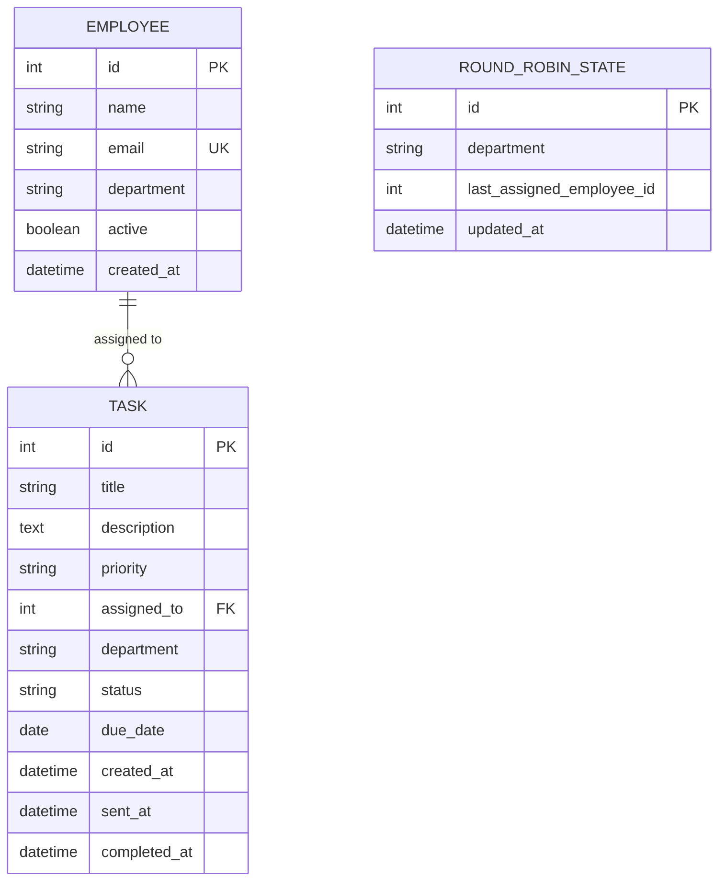

# Belvo — Enterprise Task Orchestration & Automated Email Dispatch System

<p align="center">
  
  
  
  
  
  
  
  
</p>

---

## 📌 Executive Summary

**Belvo** is an enterprise-grade internal task allotment and automated email dispatch platform. Designed for modern corporate operations, it pairs a high-performance **FastAPI** backend engine with an ultra-responsive, zero-lag **React (Vite)** dashboard and an automated **Gmail API & SMTP/IMAP email dispatch worker**.

The system automates the intake, cyclical departmental distribution, and automated outbound notification of tasks to team members with complete audit lifecycle tracking (`pending` $\rightarrow$ `sent` $\rightarrow$ `done`).

---

## 🌟 Key Capabilities & Architectural Highlights

### 1. 🏢 Deterministic Departmental Round-Robin Engine
- **11 Predefined Organizational Departments**:
  1. WhatsApp Marketing
  2. Social Media Manager
  3. HR
  4. Analyst Department
  5. Talented Engineers
  6. Cybersecurity
  7. AI/ML Department
  8. Web Developer
  9. Software Developers
  10. Graphic
  11. Founder Office
- **Dynamic "Other" Department Creation**: Create custom departments on-the-fly; new departments immediately populate into all system filters and dropdowns.
- **Department-Filtered Allocation**: When allotting tasks manually, selecting a department immediately filters candidate assignees to active members of that department.
- **Deterministic Departmental Rotation**: Automatic task allotment (`assignee="auto"`) rotates cyclically through active employees strictly within the selected department.
- **Fault-Tolerant State Persistence**: Round-robin sequence pointers are persisted in database state (`round_robin_state`), guaranteeing deterministic rotation across service restarts. Inactive employees are seamlessly skipped, while newly added employees are cleanly incorporated into subsequent cycles.

### 2. ⚡ Zero-Lag Optimistic Web Interface
- **Dual Visual Modes**: Seamless one-click toggling between an interactive **Data Table** and an agile **Kanban Board** (`Pending Delivery` $\rightarrow$ `Dispatched` $\rightarrow$ `Completed`).
- **Sub-Millisecond Optimistic UI Updates**: All task allotments, status changes, and deletions reflect immediately in memory ($0\text{ ms}$ perceived latency) before background API sync.
- **Non-Destructive Background Synchronization**: Silently polls and refreshes data without flashing full-screen loading spinners or unmounting views.
- **Zero Default Values Philosophy**: All form fields (priorities, due dates, assignees, departments) require intentional user input; forms never assume arbitrary defaults.
- **Clean Database Zero-State**: The system initializes in a pristine zero-mock state without artificial placeholder records.
- **Search & Multi-Dimensional Filtering**: Real-time debounced search across titles, descriptions, and assignees, combined with multi-filter pills (Status, Priority, Department, Assignee).

### 3. 📬 Automated Email Dispatch & Worker Pipeline
- **Dual Mail Transports**: Native support for **Google Gmail API (OAuth 2.0)** and standard **SMTP/IMAP** with secure TLS.
- **Asynchronous Background Worker**: Dedicated background worker daemon (`backend/app/services/worker.py` and standalone `email_worker/worker.py`) that continuously polls `/api/tasks/pending` and dispatches formatted notification emails.
- **Automated Lifecycle Audit**: Automatically transitions tasks to `sent` upon delivery, accurately timestamping `sent_at` and `completed_at` with UTC timezone awareness.
- **On-Demand Dispatch**: Direct "Send Email" action in the dashboard to trigger real-time notification dispatch on demand.

### 4. 👥 Comprehensive Staff Lifecycle Management
- **Full Employee Directory**: Register staff with corporate email, department, and initial rotation eligibility.
- **Permanent Cascade Deletion**: Permanently removes employees, safely cleans up associated tasks, and cleans active round-robin pointers (`DELETE /api/employees/{id}?permanent=true`).
- **Soft Deactivation**: Toggle employee active status off to bypass them from future rotations while maintaining historical task records (`DELETE /api/employees/{id}?permanent=false`).
- **Workload Metrics**: Live visualization of pending, sent, and completed task distribution per employee.

### 5. 🗄️ Multi-Database Relational Engine
- **Dual-Mode Database Adapter**: Zero-configuration local development on **SQLite**, with native production support for **PostgreSQL (Neon)** and **MySQL**.
- **Automated Startup Schema Migrations**: Automatically verifies and applies additive column migrations (`PRAGMA table_info` and `ALTER TABLE`) on startup without data loss.

---

## 🛠️ System Architecture

```
┌────────────────────────────────────────────────────────────────────────┐
│                          HR Manager Web Dashboard                      │
│        (React 18 • Vite • Lucide Icons • Optimistic UI Engine)         │
│  • Task Intake Modal (Auto / Manual)    • Staff Directory & Workload   │
│  • Departmental Filters & "Other" Dept  • Real-Time Kanban & Table     │
└───────────────────────────────────┬────────────────────────────────────┘
                                    │ HTTP / JSON (REST)
                                    ▼
┌────────────────────────────────────────────────────────────────────────┐
│                        FastAPI REST API Gateway                        │
│                 (Pydantic v2 • SQLAlchemy 2.0 • CORS)                  │
│  • /api/tasks (CRUD & Filter)           • /api/employees (Directory)   │
│  • /api/tasks/pending (Worker Poll)     • /api/auth/google (OAuth 2.0) │
│  • /api/dashboard/stats (Metrics)       • Deterministic Round-Robin    │
└───────────────────────┬───────────────────────────────┬────────────────┘
                        │                               │
            SQLAlchemy  ▼                               ▼  Dispatches
┌───────────────────────────────────────┐   ┌────────────────────────────┐
│      Relational Database Layer        │   │   Email Dispatch Worker    │
│  • SQLite (local default: belvo.db)   │   │  • Gmail API (OAuth2)      │
│  • PostgreSQL (Neon Cloud)            │   │  • SMTP / IMAP Transports  │
│  • Hosted MySQL                       │   │  • Polling Loop / Trigger  │
└───────────────────────────────────────┘   └─────────────┬──────────────┘
                                                          │ Outbound Mail
                                                          ▼
                                            ┌────────────────────────────┐
                                            │   Employee Email Inboxes   │
                                            └────────────────────────────┘
```

---

## 🗄️ Database Entity-Relationship Diagram (ERD)



---

## 📋 REST API Reference

Interactive OpenAPI documentation is available locally at **`http://localhost:8000/docs`**.

### 1. Employees (`/api/employees`)
| Method | Endpoint | Description |
| :--- | :--- | :--- |
| `GET` | `/api/employees` | List all employees. Filters: `?active=true&department=HR` |
| `POST` | `/api/employees` | Register new employee (validates unique email, accepts department) |
| `GET` | `/api/employees/{id}` | Retrieve single employee record by ID |
| `PUT` | `/api/employees/{id}` | Update employee name, email, department, or active status |
| `DELETE` | `/api/employees/{id}` | Soft-deactivate employee (`active=false`), preserving history |
| `DELETE` | `/api/employees/{id}?permanent=true` | Permanently delete employee, cascade delete tasks, reset pointer |

### 2. Tasks (`/api/tasks`)
| Method | Endpoint | Description |
| :--- | :--- | :--- |
| `GET` | `/api/tasks` | List tasks (newest first). Filters: `status`, `assignee`, `priority`, `department` |
| `POST` | `/api/tasks` | Create task with manual ID or `assignee="auto"` (department round-robin) |
| `GET` | `/api/tasks/pending` | **Worker Poll**: Retrieve all tasks with status `pending` |
| `GET` | `/api/tasks/{id}` | Retrieve single task with assigned employee relation |
| `PUT` | `/api/tasks/{id}` | Update task title, description, priority, due date, department, assignee |
| `PATCH` | `/api/tasks/{id}/status` | Advance lifecycle status (`pending` $\rightarrow$ `sent` $\rightarrow$ `done`) |
| `POST` | `/api/tasks/{id}/send-email` | Immediately dispatch task notification email via configured transport |
| `DELETE` | `/api/tasks/{id}` | Delete task record |

### 3. Dashboard & Operations (`/api/dashboard`)
| Method | Endpoint | Description |
| :--- | :--- | :--- |
| `GET` | `/api/dashboard/stats` | Real-time counts (total, pending, sent, done, active staff, workload stats) |

### 4. Google OAuth Authentication (`/api/auth/google`)
| Method | Endpoint | Description |
| :--- | :--- | :--- |
| `GET` | `/api/auth/google/login` | Initiate Google OAuth 2.0 authorization flow |
| `GET` | `/api/auth/google/callback` | OAuth2 callback exchange receiving authorization code |
| `GET` | `/api/auth/google/status` | Check if Gmail API token is currently active and valid |

---

## 💻 Local Setup & Installation

### Prerequisites
- **Python**: 3.10 or higher
- **Node.js**: 18.x or higher with npm

---

### Step 1: Clone Repository
```bash
git clone https://github.com/budigeashwinigoud-glitch/Email-Automation.git
cd Email-Automation
```

---

### Step 2: Backend Setup
```bash
cd backend

# Create & activate virtual environment
# Windows (PowerShell):
python -m venv venv
.\venv\Scripts\Activate.ps1

# Linux / macOS:
# python3 -m venv venv
# source venv/bin/activate

# Install dependencies
pip install -r requirements.txt

# Configure environment variables (optional: defaults to local SQLite)
cp .env.example .env

# Launch backend server
python -m uvicorn app.main:app --port 8000 --reload
```
- API Endpoint: **`http://localhost:8000`**
- Swagger Documentation: **`http://localhost:8000/docs`**

---

### Step 3: Frontend Setup
```bash
# In a separate terminal
cd frontend

# Install dependencies
npm install

# Start Vite development server
npm run dev
```
- Web Application: **`http://localhost:5173`**

---

### Step 4: Standalone Email Worker (Optional)
If running the email worker as an isolated microservice:
```bash
cd email_worker
pip install -r requirements.txt
python worker.py
```
*(Note: When `ENABLE_EMAIL_WORKER=true` in `backend/.env`, the worker runs automatically inside the FastAPI process).*

---

## ⚙️ Environment Variables Configuration

Copy `backend/.env.example` to `backend/.env` to configure external services:

| Variable | Default (Local) | Production Description |
| :--- | :--- | :--- |
| `DATABASE_URL` | `sqlite:///./belvo.db` | PostgreSQL (`postgresql+psycopg://...`) or MySQL connection URI |
| `CORS_ORIGINS` | `http://localhost:5173` | Allowed frontend origins (comma-separated or JSON list) |
| `FRONTEND_URL` | `http://localhost:5173` | Production web application URL |
| `ENABLE_EMAIL_WORKER` | `false` | Set to `true` to run background mail worker daemon |
| `WORKER_POLL_INTERVAL`| `30` | Polling frequency for pending tasks (seconds) |
| `SMTP_HOST` | `smtp.gmail.com` | Outgoing SMTP mail server |
| `SMTP_PORT` | `587` | SMTP port (587 for STARTTLS) |
| `SMTP_USER` | *optional* | Sender mailbox email address |
| `SMTP_PASSWORD` | *optional* | Google App Password (16 characters) |
| `GOOGLE_CLIENT_ID` | *optional* | Google Cloud OAuth2 Client ID |
| `GOOGLE_CLIENT_SECRET`| *optional* | Google Cloud OAuth2 Client Secret |

---

## 🧪 Automated Testing Suite

The platform includes exhaustive automated test coverage spanning algorithmic round-robin correctness, database consistency, cascade deletions, error handling, and end-to-end integration flows.

### Run Unit & Integration Tests (Pytest)
```bash
cd backend
.\venv\Scripts\pytest -v
```

```text
============================= test session starts =============================
platform win32 -- Python 3.13.x, pytest-9.1.1
collected 47 items

backend/tests/test_assignment.py::test_round_robin_cycle_5_employees PASSED      [  2%]
backend/tests/test_assignment.py::test_round_robin_with_different_employee_counts PASSED [  4%]
backend/tests/test_assignment.py::test_round_robin_persistence_after_restart PASSED [  6%]
backend/tests/test_assignment.py::test_deactivated_employee_skipped PASSED       [  8%]
backend/tests/test_assignment.py::test_new_employee_enters_future_round_robin PASSED [ 10%]
backend/tests/test_assignment.py::test_manual_assignment_does_not_advance_round_robin PASSED [ 12%]
backend/tests/test_assignment.py::test_no_active_employees_returns_error PASSED  [ 14%]
backend/tests/test_config.py::test_cors_origins_accepts_json_and_plain_urls PASSED [ 21%]
backend/tests/test_dashboard.py::test_dashboard_stats_empty PASSED               [ 23%]
backend/tests/test_dashboard.py::test_dashboard_stats_with_data PASSED           [ 25%]
backend/tests/test_employees.py::test_get_employees_empty PASSED                 [ 29%]
backend/tests/test_employees.py::test_create_employee PASSED                     [ 31%]
backend/tests/test_employees.py::test_create_duplicate_employee_email PASSED     [ 34%]
backend/tests/test_employees.py::test_get_employees_with_active_filter PASSED    [ 38%]
backend/tests/test_employees.py::test_update_employee PASSED                     [ 44%]
backend/tests/test_employees.py::test_deactivate_employee PASSED                 [ 51%]
backend/tests/test_employees.py::test_create_and_filter_employee_department PASSED [ 53%]
backend/tests/test_employees.py::test_delete_employee_permanent PASSED           [ 55%]
backend/tests/test_tasks.py::test_create_task_manual_assignment PASSED           [ 57%]
backend/tests/test_tasks.py::test_create_task_inactive_employee PASSED           [ 59%]
backend/tests/test_tasks.py::test_get_tasks_and_sorting PASSED                   [ 68%]
backend/tests/test_tasks.py::test_filter_tasks PASSED                            [ 70%]
backend/tests/test_tasks.py::test_get_pending_tasks PASSED                       [ 72%]
backend/tests/test_tasks.py::test_update_task_status_and_timestamps PASSED       [ 80%]
backend/tests/test_tasks.py::test_delete_task PASSED                             [ 85%]
backend/tests/test_tasks.py::test_create_task_with_department_and_round_robin PASSED [ 87%]
backend/tests/test_tasks.py::test_send_email_success PASSED                      [ 91%]
backend/tests/test_tasks.py::test_send_email_smtp_failure_preserves_pending PASSED [100%]

======================== 46 passed, 1 skipped in 2.06s ========================
```

### Run Live End-to-End Verification
```bash
python test_e2e.py
```
```text
=== STARTING FULL END-TO-END VERIFICATION ===
Step 1: Database checked.
Step 2: Created dynamic employees across departments.
Step 4: Manually assigned task verified.
Step 5: Cyclical round-robin sequence and wrap-around verified!
Step 6: Deactivated next-in-line employee.
Step 7: Inactive employee skipped; assigned to next active member.
Step 8: Pending task queue poll verified.
Step 9: Status transition to 'sent' verified with sent_at audit timestamp.
Step 10: Status transition to 'done' verified with completed_at audit timestamp.
Step 14: Final dashboard statistical aggregations verified.
Step 16: Zero-state database clean-up verified.

[SUCCESS] ALL 16 LIVE END-TO-END VERIFICATION CHECKS PASSED PERFECTLY!
```

---

## 🚀 Cloud Deployment Architecture (Render + Vercel + Neon)

The repository includes a ready-to-use Render Blueprint specification (`render.yaml`) and deployment guide (`DEPLOYMENT.md`):

1. **Frontend**: Deployed on **Vercel** (`Root Directory: frontend`, build command: `npm run build`, output: `dist`).
2. **Backend API**: Deployed on **Render** as a Python Web Service (`Root Directory: backend`, start command: `uvicorn app.main:app --host 0.0.0.0 --port $PORT`).
3. **Database**: Hosted **PostgreSQL on Neon** connected securely via `DATABASE_URL`.
4. **Environment Connection**: Set `VITE_API_URL` on Vercel pointing to the Render HTTPS origin, and set `CORS_ORIGINS` and `FRONTEND_URL` on Render.

---

## 📄 License & Attribution

Distributed under the MIT License. Developed for enterprise task allocation and automated outbound email orchestration.
